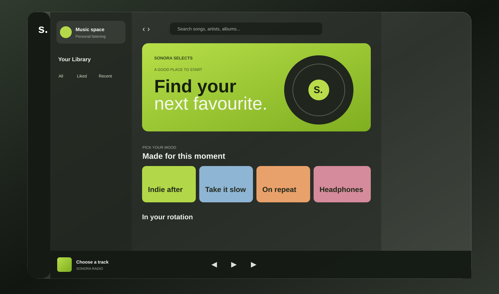

<div align="center">

  

  <h1>SONORA</h1>
  <p><strong>A quieter place to find your next favourite track.</strong></p>
  <p>A music discovery and preview player with a spatial listening-room interface, live catalogue search and a minimal, tactile playback experience.</p>

  <p>
    <a href="https://github.com/ansh44233/sonora-listening-room"></a>
    
    
    
    
    
  </p>

  <p>
    <a href="#-experience">Experience</a> ·
    <a href="#-features">Features</a> ·
    <a href="#-how-it-works">How it works</a> ·
    <a href="#-run-locally">Run locally</a> ·
    <a href="#-deployment">Deployment</a>
  </p>

</div>

---

## The idea

Music apps can make listening feel like managing a dashboard. SONORA takes a different direction: a calm, dark listening space where discovery, artwork and playback live together.

The project is built with plain HTML, CSS and JavaScript. It uses the Apple iTunes Search API to find catalogue entries and play the preview audio URLs returned for eligible tracks.

> **What SONORA is:** a music discovery interface and preview player.  
> **What it isn't:** a music-hosting service or a replacement for a full streaming subscription.

## ✦ Experience

The interface is organised around three areas:

| Area | Purpose |
| --- | --- |
| **Your Library** | A compact space for liked tracks saved in the current browser. |
| **Listening Room** | Search, explore mood-based queries and browse matching tracks. |
| **Now Playing** | Artwork, queue preview and the current listening controls. |

The artwork above is an illustrative project visual, not a captured browser screenshot.

## Features

- **Catalogue search** — search by artist, song or album through the iTunes Search API.
- **Preview playback** — play and pause the preview URL returned for a track.
- **Playback controls** — previous, next, shuffle, repeat, volume and seek.
- **Liked tracks** — save and remove favourites using browser local storage.
- **Mood discovery** — quick searches for indie, chill, pop and focus listening.
- **Queue view** — see other tracks from the current result set.
- **Apple Music hand-off** — open the catalogue listing to continue listening there.
- **Responsive layout** — dedicated desktop and mobile layouts.
- **Reduced-motion support** — respects the operating system's reduced-motion preference.

Some interface elements are presentation-only or placeholders. Playlist creation, for example, is not implemented yet.

## Built with

| Technology | Role |
| --- | --- |
| HTML5 | Page structure and accessible controls |
| CSS3 | Responsive layout, glass effects, motion and visual system |
| Vanilla JavaScript | Search, player state, rendering and interactions |
| Apple iTunes Search API | Track metadata, artwork and preview URLs |
| HTMLAudioElement | Browser audio playback |
| localStorage | Persist liked track IDs in the current browser |
| Vercel | Static deployment target |

No API key or backend service is required for the current search flow.

## How it works

```text
User searches or picks a mood
            |
            v
  iTunes Search API request
            |
            v
 Filter results with preview URLs
            |
            v
 Render tracks, artwork and queue
            |
            v
 HTMLAudioElement plays preview
            |
            v
 Liked track IDs saved locally
```

### Data and privacy notes

- Search requests go directly from the browser to Apple's public iTunes Search endpoint.
- SONORA does not upload, host or download audio.
- Liked track IDs are stored in the browser's `localStorage`; they are not synced across devices.
- Track names, artwork, preview availability and Apple Music links come from the external catalogue.
- Preview clips are samples, not guaranteed full-length tracks. Availability can vary by catalogue entry and region.

## Project structure

```text
sonora-listening-room/
├── assets/
│   └── preview.svg       # Illustrative project artwork
├── app.js                # Search, player state and UI rendering
├── index.html            # Main application structure
├── styles.css            # Visual system and responsive layouts
├── vercel.json           # Static deployment configuration
├── LICENSE
└── README.md
```

## Run locally

You only need a modern browser and a local static server. There is no build step and no package installation.

```bash
git clone https://github.com/ansh44233/sonora-listening-room.git
cd sonora-listening-room
python -m http.server 4173
```

Then open **http://localhost:4173**.

You can also use the VS Code Live Server extension or another static file server.

## Deployment

SONORA is a static site and can be deployed directly to Vercel.

1. Import this repository in [Vercel](https://vercel.com/new).
2. Select **Other** as the framework preset.
3. Leave the build command and output directory empty/default for a root-level static site.
4. Deploy.

Every push to the connected production branch can trigger a new deployment.

## Current scope

| Area | Status |
| --- | --- |
| Search catalogue | Implemented |
| Preview audio playback | Implemented |
| Player controls | Implemented |
| Like / unlike tracks | Implemented |
| Browser-local persistence | Implemented |
| Mood-based discovery | Implemented |
| Responsive styling | Implemented |
| Playlist creation | Not implemented |
| Account login / cloud sync | Not implemented |
| Full-length streaming | Not provided |

## Roadmap

- [ ] Add automated tests for search and playback state.
- [ ] Improve keyboard navigation and screen-reader announcements.
- [ ] Add a proper playlist model and playlist editing.
- [ ] Add persistent search history.
- [ ] Capture real desktop and mobile screenshots after browser QA.
- [ ] Add CI checks for formatting and basic regression tests.

## Contributing

Ideas, bug reports and improvements are welcome. For larger changes, open an issue first so the scope can be discussed before a pull request.

## License

Released under the [MIT License](LICENSE).

---

<div align="center">
  <sub>Designed and built as an independent front-end project. Made for the love of listening.</sub>
</div>
